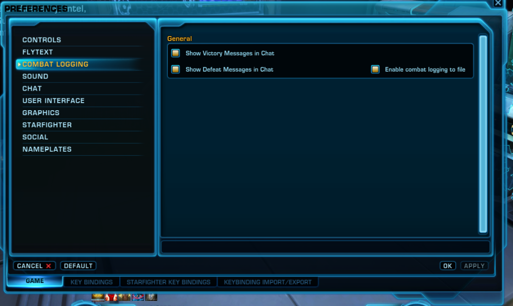

# SWTOR Holocron DPS — Live In-Game Overlay & Combat Log Parser

A lightweight, local-first live DPS parser and Always-On-Top overlay for **Star Wars: The Old Republic (SWTOR)** (supporting both 7.0+ *Legacy of the Sith* and classic combat logs).

## Features
- **Smart Log Directory Auto-Discovery & Custom Folder Selector:**
  - Automatically scans Windows Registry (`User Shell Folders\Personal`), `OneDrive` / `OneDriveConsumer` / `OneDriveCommercial` folders, standard `Documents`, and secondary drives (`D:`, `E:`, `F:`, `G:`) to locate your `CombatLogs` folder and pick the one with the newest logs.
  - Allows you to browse for a custom folder (`📂 Folder` button), paste a custom path, or pick from a ranked list of auto-detected candidate locations in **❓ Setup & Help** (saved automatically across restarts).
- **Real-Time Metrics (250ms updates):**
  - Personal **DPS**, **Total Damage**, **Crit %**, **Accuracy %**, **APM**, **HPS**, and **DTPS**
  - Live **Real-Time DPS Curve** sparkline and **Boss HP Bar**
  - Detailed **Ability Breakdown** (hits, crits, max hit, average hit, damage share, DPS)
  - **Group Raid DPS** and **Healing & Tank** tabs with automatic Combat Style / Discipline detection
  - **Historical Reference Points & Cross-Session Analysis (`📈 History` & `⭐ Save Ref`):**
  - Save any encounter as a persistent **Reference Point** (`%APPDATA%\SWTOR_Holocron_DPS\history_references.json`) with custom gear/build tags (e.g., `"340 Gear Baseline"`, `"New Tactical"`, `"Ops Dummy"`).
  - **🎯 Active Baseline Live Comparison:** Pin any saved Reference Point as your active baseline to see real-time **$\Delta$ DPS**, **$\Delta$ Crit %**, and **per-ability $\Delta$ DPS** gains/losses right on the live HUD during combat.
  - **Cross-Session Progression Chart:** Track Best DPS, Average DPS, and progression trends across sessions, filterable by Target or Combat Style/Spec.
  - **📜 Import From Past Log Files:** Scan past `combat_*.txt` files in your `CombatLogs` folder across previous gaming sessions and bookmark notable boss fights or parses into your reference library.
- **In-Game Overlay Controls:**
  - **📌 Pin (Always On Top):** Stays visible over SWTOR when playing in *Fullscreen (Windowed)* mode
  - **▣ Mini HUD Mode:** Collapses the window into a compact stat bar during boss pulls
  - **⚡ Demo Fight:** Built-in combat log simulator to preview and test the meter anytime
  - **❓ Setup & Help:** Visual guide showing how to turn on combat logging in SWTOR and locate your log files

---

## Quick Start (Standalone Windows Executable)
1. Download and run **[`SWTOR_DPS_Parser.exe`](SWTOR_DPS_Parser.exe)** directly—no Python installation required.
2. In SWTOR, open **Preferences (`ESC` or `Ctrl + P`) → Game → Combat Logging** and check **☑ Enable combat logging to file**.
3. Set SWTOR Graphics Display Mode to **Fullscreen (Windowed)** so the pinned overlay stays visible over the game.



---

## Where SWTOR Saves Your Combat Log Files
- **Standard Windows Path:**
  `C:\Users\<YourUsername>\Documents\Star Wars - The Old Republic\CombatLogs`
- **OneDrive Redirected Path:**
  `C:\Users\<YourUsername>\OneDrive\Documents\Star Wars - The Old Republic\CombatLogs`

See **[`HELP_How_To_Enable_Combat_Logging.html`](HELP_How_To_Enable_Combat_Logging.html)** for the full illustrated setup guide.

---

## Running from Source / Building the Executable
```powershell
# Run desktop overlay from source
python app.py

# Or test in a local web browser at http://127.0.0.1:8765
python app.py --browser

# Run unit tests
python -m unittest test_parser.py

# Build standalone single-file executable
python -m PyInstaller --noconfirm --onefile --windowed --name "SWTOR_DPS_Parser" --add-data "overlay_ui.html;." --add-data "HELP_How_To_Enable_Combat_Logging.html;." --add-data "swtor_combat_logging_help.png;." app.py
```
