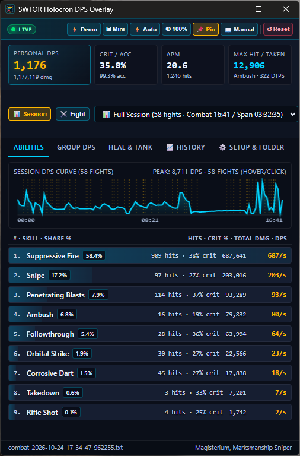

# SWTOR Holocron DPS — Live In-Game Overlay & Combat Log Parser

A lightweight, local-first live DPS parser, multi-hour session aggregator, and Always-On-Top Windows overlay for **Star Wars: The Old Republic (SWTOR)** (supporting both 7.0+ *Legacy of the Sith* and classic combat logs).



---

## Key Features
- **Full Play Session Aggregation (`📊 Session`) & Single-Pull (`⚔️ Fight`) Modes:**
  - **📊 Session Mode (Default):** Aggregates **all encounters, skills, and abilities** (`Suppressive Fire`, `Snipe`, `Penetrating Blasts`, `Ambush`, `Followthrough`, `Orbital Strike`, etc.) across your entire 1–3+ hour play session (`Time-to-Date`) without resetting between pulls. Tracks both **Active Combat Time** and **Total Session Span**.
  - **⚔️ Fight Mode & Pull Selector:** Switch with one click to inspect only the current/latest NPC fight or any individual encounter (`#1..#N`) in your session, or click any spike directly on the **Session DPS Curve** to jump to that pull.
- **Interactive Session DPS Curve & High-Contrast Ability Breakdown:**
  - Real-time DPS curve with start/mid/end time axis labels, vertical dashed fight-boundary markers across multi-pull sessions, hover tooltips showing exact pull DPS, and click-to-inspect.
  - Preattentive ability share bars (`%` of total damage), hit & crit rates (`909 hits · 38% crit`), total damage, and right-aligned DPS—all tuned to exceed WCAG 1.4.3 AA contrast requirements.
  - Context-aware KPI cards: **Personal DPS** (with live baseline $\Delta$), **Crit / Acc**, **APM**, and **Max Hit / Taken** (showing your largest single hit, ability name, and `DTPS`, or switching automatically to `HPS / Taken` for healers).
- **In-Game Overlay Controls (`📌 Pin`, `▣ Mini`, `⚡ Auto`, `◐ Opacity`, Safe `↺ Reset`):**
  - **📌 Pin (Always On Top):** Stays visible over SWTOR when playing in *Fullscreen (Windowed)* mode.
  - **▣ Mini & ⚡ Auto-Mini:** Collapses the window into a compact 4-tile HUD bar during combat and automatically expands after combat when `⚡ Auto` is active.
  - **◐ 100% / 85% / 70% Opacity:** Native Win32 layered window transparency so you can see the game world clearly behind the meter.
  - **Protected `↺ Reset` with `↩ Undo`:** Separated from live controls with a 2-step confirmation (`⚠ Confirm?`) and a 15-second **`↩ Undo`** recovery button so you never accidentally wipe a 2-hour session.
- **One-Click Copy to Windows Clipboard for SWTOR In-Game Chat (`📋 Chat` & `👥 Team`):**
  - **Personal DPS Summary (`📋 Chat`):** Click **`📋 Chat`** in the Encounter Bar, the **`📋`** icon on the Personal DPS card (including in `▣ Mini` HUD mode), or **`📋`** on any individual player's row in `Group DPS` to copy a single-line summary (`<= 250` characters) ready to paste (`Ctrl + V`) into `/p`, `/ops`, `/g`, or `/s` chat:
    `[Holocron Session] Magisterium, Marksmanship Sniper (58 fights, 17:45 combat / 51:15 span): 364 DPS (388,022 dmg) | Crit 37.9% | Acc 100.0% | 46.7 APM | Max 3,922 (Ambush) | Top: Suppressive Fire 51%, Snipe 18%, Penetrating Blasts 10%`
  - **Whole-Team Group DPS & Heal/Tank Leaderboard (`👥 Team Chat` / `👥 Copy Team DPS for Chat`):** When on the **`Group DPS`** tab (or by clicking **`👥 Team`** in the Encounter Bar or `📈 History`), copy the entire team's ranked DPS leaderboard (`#1..#N` with DPS, `%` share of team damage, Crit %, and Total Team DPS) in one paste for the whole party/ops group to see:
    `[Holocron Team] Odessen (86 fights, 25:01) | Team: 24,898/s (37.27M) || 1. Slighted 9,398/s (38%, 62%c) | 2. Magisterium 6,128/s (25%, 40%c) | 3. Monarorx Ragnos 5,896/s (24%, 56%c) | 4. Visible Ghost 1,753/s (7%, 37%c) | 5. Hundred Forty-five 1,671/s (7%, 43%c)`
- **Named Session Saving & Cross-Session Historical Analysis (`📈 History` & `💾 Save`):**
  - Save an entire play session under a custom **Session Name** (or save individual boss fights) to `%APPDATA%\SWTOR_Holocron_DPS\history_references.json` with all recorded skills & abilities preserved.
  - **🎯 Active Baseline Live Comparison:** Pin any saved Session or Fight as your active baseline to see real-time **$\Delta$ DPS**, **$\Delta$ Crit %**, and **per-ability $\Delta$ DPS** gains/losses right on the live HUD.
  - **📜 Import From Past Log Files:** Scan past `combat_*.txt` files in your `CombatLogs` folder and import either the **📦 Full Play Session** or specific boss encounters into your reference library.
- **Smart Log Directory Auto-Discovery (`⚙️ Setup & Folder`):**
  - Automatically scans Windows Registry (`User Shell Folders\Personal`), `OneDrive` folders, standard `Documents`, and secondary drives (`D:`, `E:`, `F:`, `G:`) to locate your `CombatLogs` folder and pick the one with the newest logs.

---

## Quick Start (Standalone Windows Executable)
1. Download and run **[`SWTOR_DPS_Parser.exe`](SWTOR_DPS_Parser.exe)** directly—no Python installation required.
2. In SWTOR, open **Preferences (`ESC` or `Ctrl + P`) → Game → Combat Logging** and check **☑ Enable combat logging to file**.
3. Set SWTOR Graphics Display Mode to **Fullscreen (Windowed)** so the pinned overlay stays visible over the game.


---

## Where SWTOR Saves Your Combat Log Files
- **Standard Windows Path:**
  `C:\Users\<YourUsername>\Documents\Star Wars - The Old Republic\CombatLogs`
- **OneDrive Redirected Path:**
  `C:\Users\<YourUsername>\OneDrive\Documents\Star Wars - The Old Republic\CombatLogs`

See **[`HELP_How_To_Enable_Combat_Logging.html`](HELP_How_To_Enable_Combat_Logging.html)** (or click **`📖 Manual`** in the app header) for the full illustrated setup and overlay guide.

---

## Running from Source / Building the Executable
```powershell
# Run desktop overlay from source
python app.py

# Or test in a local web browser at http://127.0.0.1:8765
python app.py --browser

# Run unit tests
python -m unittest test_parser.py

# Build standalone single-file executable
pyinstaller --noconfirm SWTOR_DPS_Parser.spec
```
